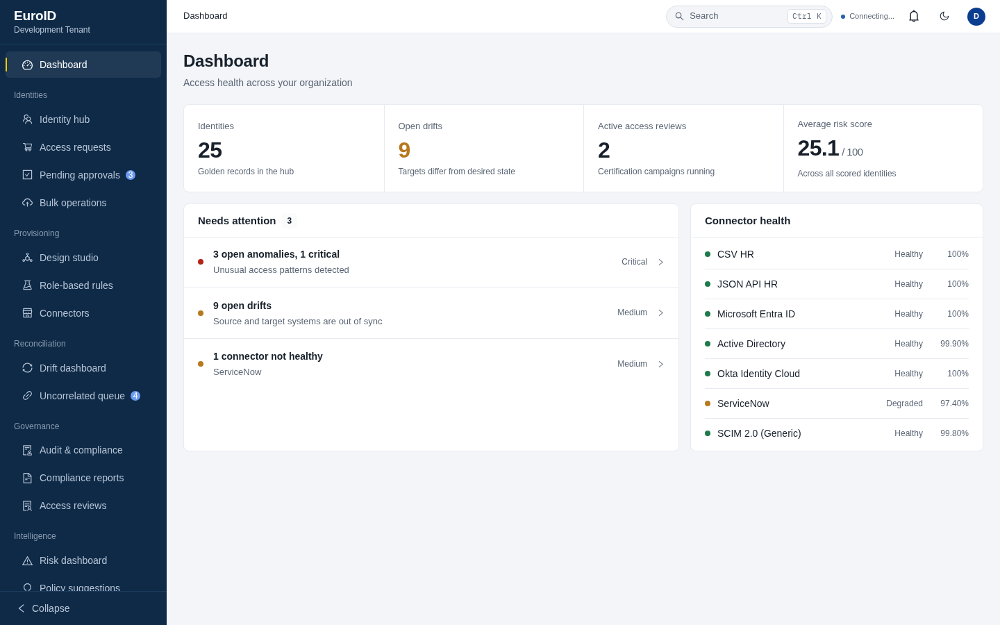

# Kalle Huttunen

Independent IT architect in Kuopio, Finland. I take on the hardest IT problems from scratch, often ones several people have already called impossible, and build the missing pieces until the whole thing works.

I came up through helpdesk, service desk, systems administration and projects before moving into architecture. Most of what I build rests on the same basics: identity and access management, the data lifecycle, integrations, security and controlled rollouts.

[LinkedIn](https://linkedin.com/in/kalle-huttunen)

## Projects

### [EuroID](https://github.com/kalle-huttunen/EuroID-public)

Identity governance and administration (IGA) platform. HR data becomes one golden record per person, a policy engine decides who gets which access, and Temporal workflows provision it to Entra ID, Active Directory, Okta, SCIM, ServiceNow, GitHub and others. Reconciliation finds manual changes made in the target systems. A proof of concept, not a deployed product.

NestJS · Temporal · MongoDB · React · TypeScript

### [chatbot-widget](https://github.com/kalle-huttunen/chatbot-widget)

Dependency-free chat widget for a website. Plain JavaScript and CSS in the browser, one PHP file that talks to the OpenAI API so the key stays on the server, and optional HubSpot lead capture. English and Finnish. MIT licensed.

JavaScript · CSS · PHP
